# isb

[](https://crates.io/crates/isb)
[](https://pypi.org/project/isb-sdk/)
[](https://www.npmjs.com/package/@execution-associates/isb)
[](https://github.com/execution-associates/isb/actions/workflows/ci.yml)
[](LICENSE)

**Sandboxes you can describe, on your own Linux machine.** Write down the
containers or VMs you want in a small YAML file, or in Python, TypeScript or
Rust, and isb makes [incus](https://linuxcontainers.org/incus/) match it:
creating what is missing and changing only what differs, every time you run it.

The same binary is also a small self-hosted platform: orgs with their own
network and quotas, apps deployed from an image or git, databases and backups,
domains with certificates, a web UI, and an MCP server for AI agents.

- **For agents and untrusted code:** each task gets its own machine with one
  directory mounted, not your home directory and its credentials.
- **For a dev environment per branch:** one sandbox per worktree, side by
  side, with hot reload that survives every `isb up`.
- **For apps that run for months:** replicated, health-checked,
  load-balanced services with rolling updates, from the same file.

## What it looks like

<table>
  <tr>
    <td width="33%" align="center" valign="top">
      <a href="docs/assets/readme/sandbox.webp">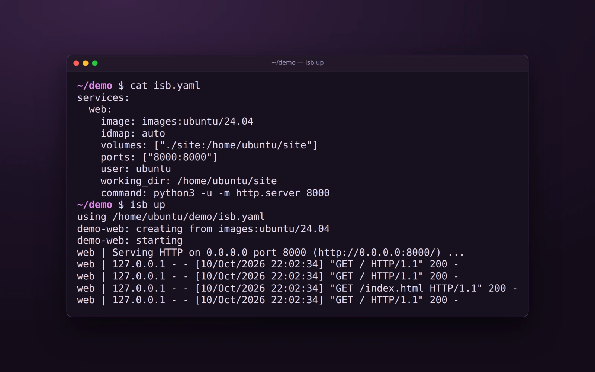</a><br>
      <b>Sandboxes from a file</b><br>
      <a href="docs/getting-started/first-sandbox.md">Your first sandbox →</a>
    </td>
    <td width="33%" align="center" valign="top">
      <a href="docs/assets/readme/agents.webp">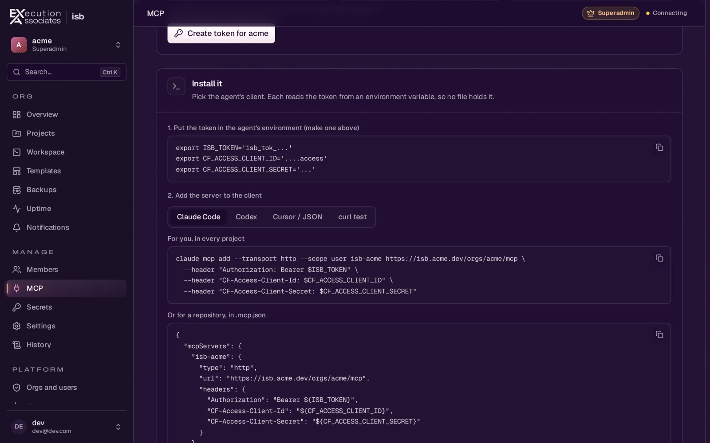</a><br>
      <b>Agents and MCP</b><br>
      <a href="docs/guides/agents.md">Agents and MCP →</a>
    </td>
    <td width="33%" align="center" valign="top">
      <a href="docs/assets/readme/workspace.webp">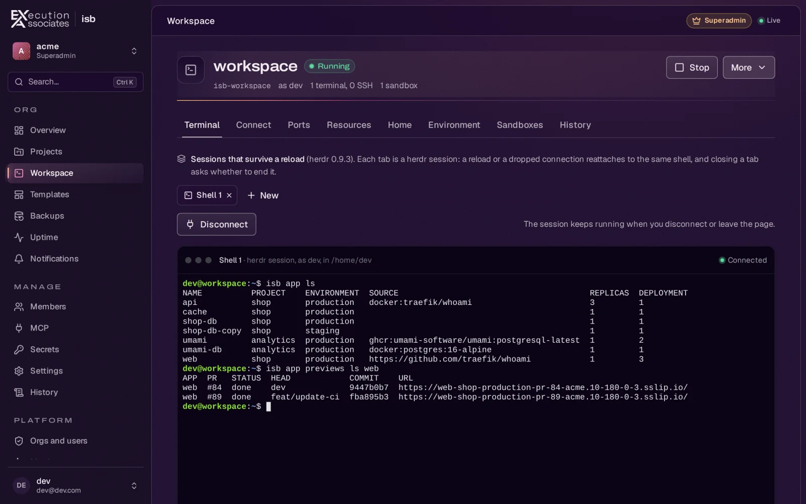</a><br>
      <b>Workspaces for agents</b><br>
      <a href="docs/concepts/workspaces.md">Workspaces →</a>
    </td>
  </tr>
  <tr>
    <td width="33%" align="center" valign="top">
      <a href="docs/assets/readme/deploy.webp">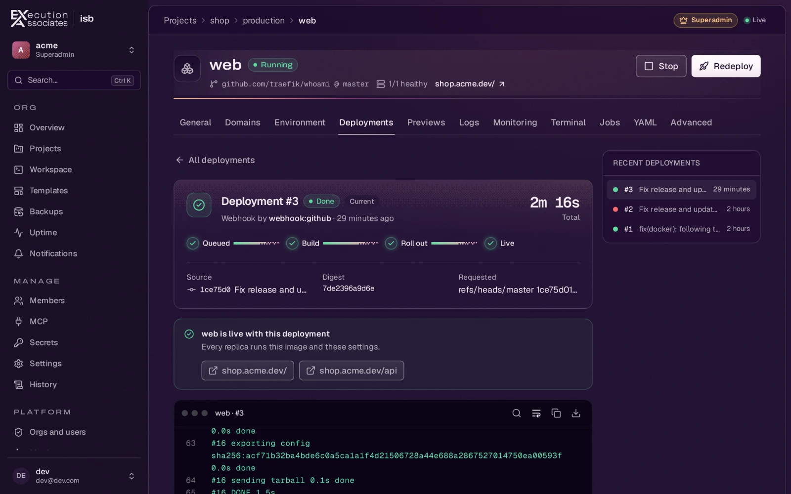</a><br>
      <b>Deploy from an image or git</b><br>
      <a href="docs/guides/deploy-apps.md">Deploy apps →</a>
    </td>
    <td width="33%" align="center" valign="top">
      <a href="docs/assets/readme/templates.webp">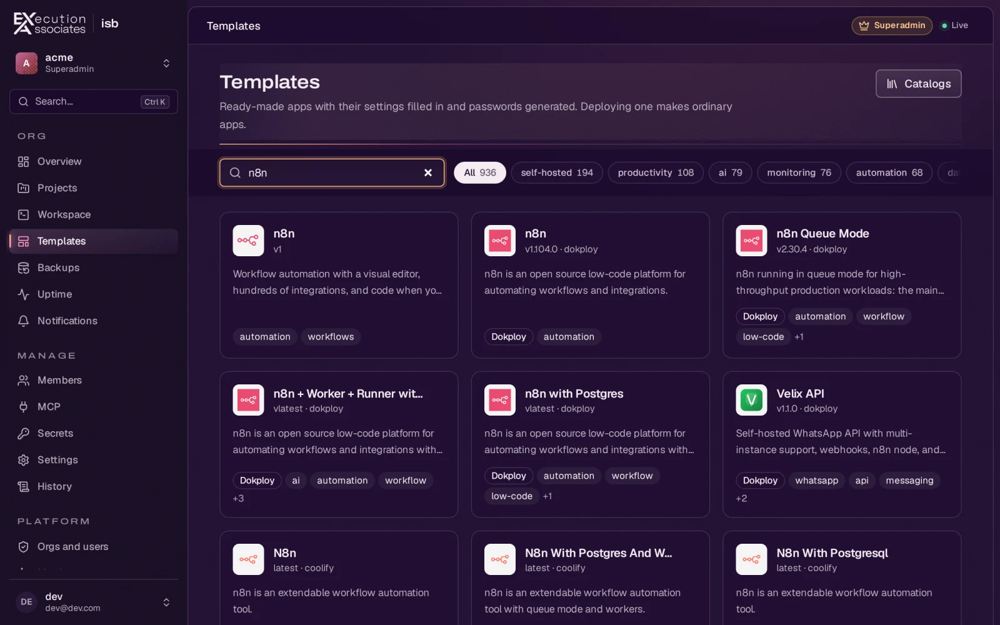</a><br>
      <b>Templates, with Dokploy's and Coolify's catalogs</b><br>
      <a href="docs/guides/templates.md">Templates →</a> ·
      <a href="docs/guides/from-dokploy.md">from Dokploy</a> ·
      <a href="docs/guides/from-coolify.md">from Coolify</a>
    </td>
    <td width="33%" align="center" valign="top">
      <a href="docs/assets/readme/previews.webp">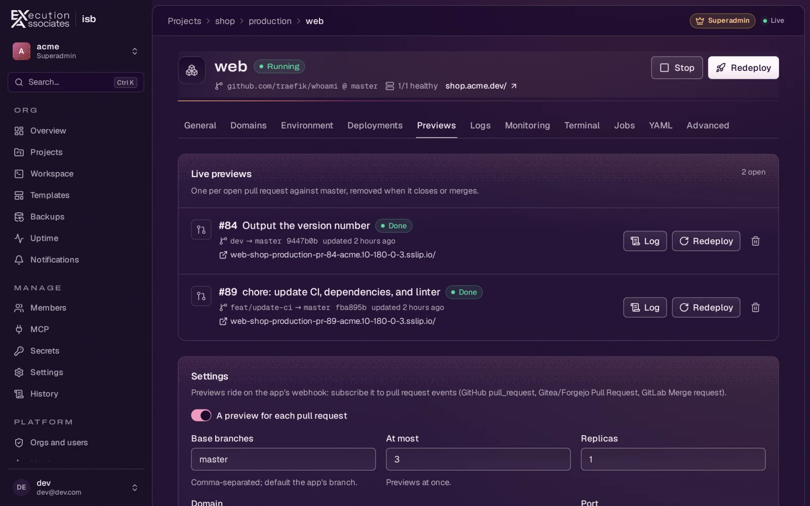</a><br>
      <b>Preview deployments</b><br>
      <a href="docs/guides/previews.md">Previews →</a>
    </td>
  </tr>
  <tr>
    <td width="33%" align="center" valign="top">
      <a href="docs/assets/readme/secrets.webp">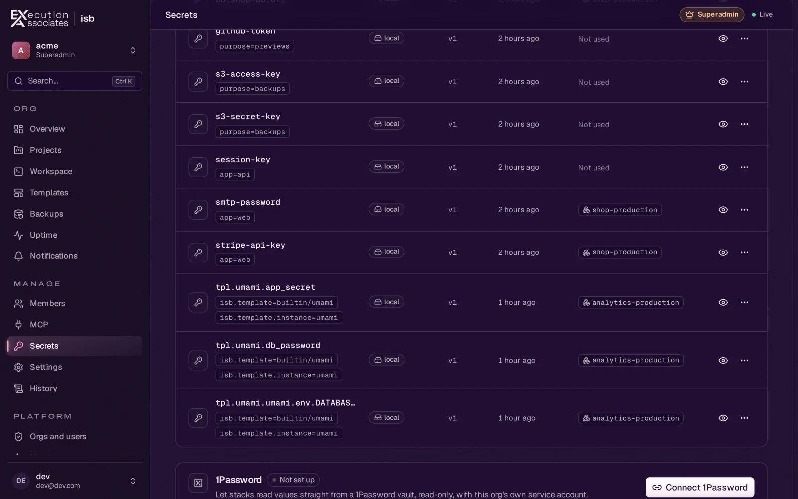</a><br>
      <b>Secrets, local or from 1Password</b><br>
      <a href="docs/guides/secrets.md">Secrets →</a>
    </td>
    <td width="33%" align="center" valign="top">
      <a href="docs/assets/readme/domains.webp">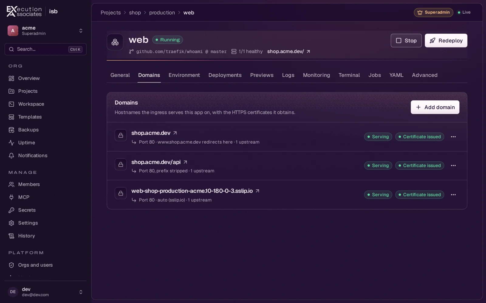</a><br>
      <b>Domains with HTTPS</b><br>
      <a href="docs/guides/domains.md">Domains and ingress →</a>
    </td>
    <td width="33%" align="center" valign="top">
      <a href="docs/assets/readme/ssh.webp">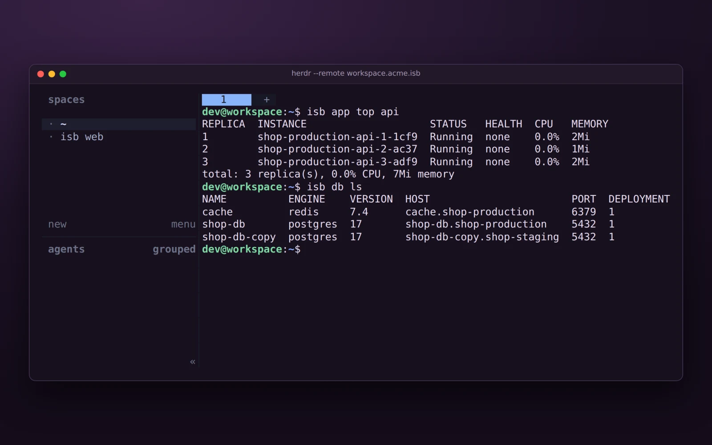</a><br>
      <b>SSH and herdr</b><br>
      <a href="docs/guides/ssh.md">SSH and herdr →</a>
    </td>
  </tr>
  <tr>
    <td width="33%" align="center" valign="top">
      <a href="docs/assets/readme/databases.webp">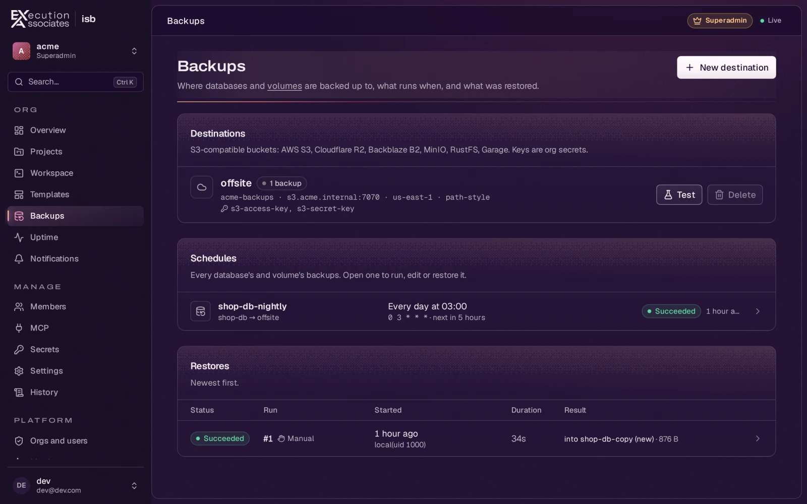</a><br>
      <b>Databases and backups</b><br>
      <a href="docs/guides/databases.md">Databases →</a>
    </td>
    <td width="33%" align="center" valign="top">
      <a href="docs/assets/readme/uptime.webp">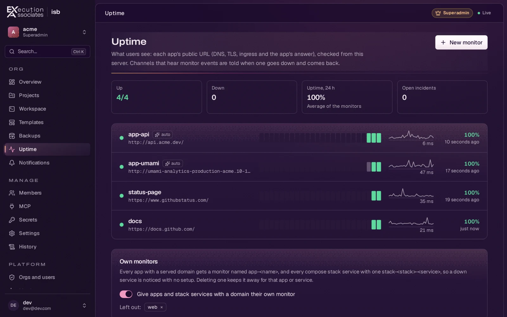</a><br>
      <b>Uptime monitoring</b><br>
      <a href="docs/guides/uptime.md">Uptime →</a>
    </td>
    <td width="33%" align="center" valign="top">
      <a href="docs/assets/readme/tui.webp">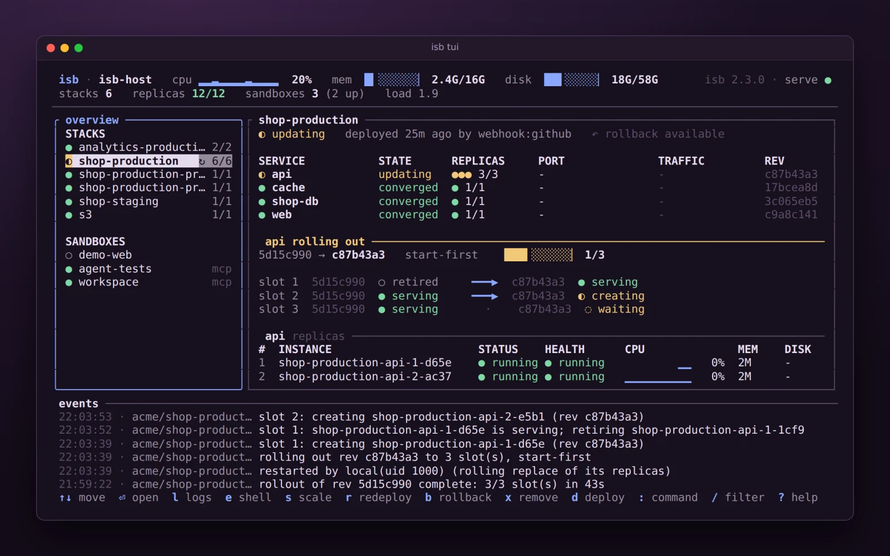</a><br>
      <b>The terminal dashboard</b><br>
      <a href="docs/reference/tui.md">isb tui →</a>
    </td>
  </tr>
</table>

## Install

isb needs a Linux host with [incus](https://linuxcontainers.org/incus/docs/main/installing/)
and access to its socket (usually the `incus-admin` group, which is
root-equivalent on that host). On macOS, isb runs incus in a Lima VM it
manages (`brew install lima openssl@3`, the installer below, then
`isb machine init`).

```sh
curl -fsSL https://github.com/execution-associates/isb/releases/latest/download/install.sh | sh
# the CLI: one static binary in ~/.local/bin, its release signature checked;
# `isb update` keeps it current. Or build it: cargo install isb

pip install isb-sdk                           # Python SDK (imported as `isb`)
bun add @execution-associates/isb             # TypeScript SDK
cargo add isb                                 # Rust library
```

## Quick start

```yaml
# isb.yaml
services:
  web:
    image: images:ubuntu/24.04
    idmap: auto                  # files you create inside stay yours outside
    volumes: ["./site:/home/ubuntu/site"]
    ports: ["8000:8000"]         # on the host's 127.0.0.1
    user: ubuntu
    working_dir: /home/ubuntu/site
    command: python3 -u -m http.server 8000
```

```console
$ isb up                  # create it (or fix only what drifted), run `command`
web | Serving HTTP on 0.0.0.0 port 8000 (http://0.0.0.0:8000/) ...
^C                        # stops the sandbox; the next `isb up` starts it again
$ isb up -d               # or: create, wait until ready, return
$ isb exec web -- python3 -m unittest
$ isb down                # delete it, host untouched
```

To run the platform, install the daemon and deploy an app:

```console
$ isb serve install                     # the daemon, as a systemd user service (sets the host up with sudo the first time)
$ isb project create shop               # in the default org, which the daemon creates
$ isb app create web --project shop --image docker:traefik/whoami -p 127.0.0.1:8080:80 --deploy
```

## Documentation

- [Overview](docs/index.md): what isb is, who it is for, and why
- [Getting started](docs/getting-started/index.md): install, your first
  sandbox, your first org and app, the web UI
- [Concepts](docs/concepts/index.md): sandboxes, orgs, apps, stacks,
  workspaces, the security model, users and roles
- [Guides](docs/guides/index.md): deploying apps, builds, databases and
  backups, domains, secrets, agents and MCP, SSH, dev environments
- [Reference](docs/reference/index.md): the CLI, `isb.yaml`, MCP tools, the
  HTTP API, configuration, the rpc protocol
- [Operations](docs/operations/index.md): host setup, upgrades, backups,
  audit log, history, metrics, troubleshooting
- [Contributing](docs/contributing/index.md): building and testing isb
- [SKILL.md](SKILL.md): an agent skill for isb. Put it in your agent's skills
  directory (for Claude Code, `~/.claude/skills/isb/SKILL.md`)

## License

[MIT](LICENSE)
